# Claude Code: Complete Research Guide

> **Last Updated:** May 2026 | **Audience:** Software Engineers | **Level:** Beginner → Advanced

---

## Table of Contents

1. [Introduction](#1-introduction)
2. [Core Concepts](#2-core-concepts)
3. [Commands and Skills](#3-commands-and-skills)
4. [Operational Modes](#4-operational-modes)
5. [Context Window Management](#5-context-window-management)
6. [Memory System](#6-memory-system)
7. [Tools and Tool Use](#7-tools-and-tool-use)
8. [Permission System](#8-permission-system)
9. [Project Configuration](#9-project-configuration)
10. [Git Integration](#10-git-integration)
11. [Code Quality and Safety](#11-code-quality-and-safety)
12. [Safety Guardrails](#12-safety-guardrails)
13. [Advanced Workflows](#13-advanced-workflows)
14. [Best Practices](#14-best-practices)
15. [Troubleshooting](#15-troubleshooting)
16. [API and SDK Integration](#16-api-and-sdk-integration)
17. [MCP (Model Context Protocol)](#17-mcp-model-context-protocol)
18. [Performance Optimization](#18-performance-optimization)
19. [Integration with Development Tools](#19-integration-with-development-tools)
20. [Real-World Examples](#20-real-world-examples)
21. [Tips and Tricks](#21-tips-and-tricks)
22. [Limitations and Workarounds](#22-limitations-and-workarounds)
23. [Comparison Matrix](#23-comparison-matrix)
24. [Appendices](#24-appendices)
25. [Quick Reference](#25-quick-reference)

---

## 1. Introduction

### 1.1 What is Claude Code?

**Claude Code** is an agentic, terminal-based AI coding assistant built by Anthropic. Unlike traditional autocomplete plugins that suggest the next line, Claude Code operates as a **fully autonomous agent** that can:

- Read and understand your **entire codebase**
- Plan and execute **multi-step engineering tasks**
- Run **shell commands**, tests, and scripts
- Perform **Git operations** (commit, branch, PR)
- Search the web and fetch documentation
- Spawn **subagents** to parallelize complex work

You interact with it in natural language, and it does the rest.

```bash
# Install Claude Code (macOS/Linux/WSL)
curl -fsSL https://claude.ai/install.sh | bash

# Or via Homebrew
brew install --cask claude-code

# Start a session in your project
cd my-project
claude
```

**Key differentiator:** Claude Code doesn't just suggest code — it *acts*. It explores your repo, writes files, runs tests, and verifies results, all within a controlled permission system.

---

### 1.2 Claude Code vs Other AI Coding Assistants

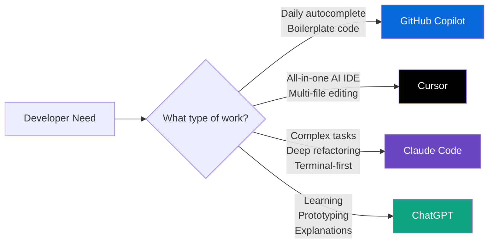

#### Comparison with Cursor
| Dimension | Claude Code | Cursor |
|---|---|---|
| **Interface** | Terminal-first | AI-native IDE (VS Code fork) |
| **Context** | 200K–1M token window | Project-indexed embeddings |
| **Best for** | Complex agentic tasks, refactors | Daily editing, multi-file features |
| **Model** | Claude (Anthropic only) | Model-agnostic (GPT-4, Claude, etc.) |
| **Autonomy** | Full agentic loop | Mostly editor-level assistance |
| **Price** | Claude.ai subscription / API | $20/mo Pro |

#### Comparison with GitHub Copilot
| Dimension | Claude Code | GitHub Copilot |
|---|---|---|
| **Interface** | Terminal + IDE extensions | IDE plugins everywhere |
| **Strengths** | Deep reasoning, agentic tasks | Autocomplete, ecosystem breadth |
| **Enterprise** | Emerging | Mature (SOC 2, SSO) |
| **Execution** | Runs commands autonomously | Suggests only, never executes |
| **Context** | Full codebase reads | File-level context |

#### Comparison with ChatGPT Code Interpreter
| Dimension | Claude Code | ChatGPT Code Interpreter |
|---|---|---|
| **Environment** | Your local machine | Sandboxed cloud container |
| **File access** | Full local filesystem | Upload/download only |
| **Git ops** | Native | None |
| **Best for** | Real engineering work | Data analysis, prototyping |
| **Persistence** | Works with your actual repo | Session-ephemeral |

---

### 1.3 Available Interfaces

#### CLI (Command Line Interface) — Primary Interface
```bash
# Interactive session
claude

# One-shot with prompt
claude "Refactor the auth module to use JWT"

# With initial file context
claude --add-file src/auth.ts "Fix the token expiry bug"
```

#### Desktop App (Mac/Windows)
- Native application wrapping the Claude.ai experience
- Supports file drag-and-drop
- Available at [claude.ai/download](https://claude.ai/download)

#### Web App (claude.ai)
- Browser-based access at **claude.ai/code**
- Full chat interface with file upload
- No local installation required
- Limited to file uploads (no local shell execution)

#### IDE Extensions
- **VS Code:** Available in the Extensions marketplace
- **JetBrains (IntelliJ, WebStorm, PyCharm):** Available via JetBrains Marketplace
- Both extensions provide inline suggestions and panel chat, bridging the gap between terminal-level power and IDE comfort

---

### 1.4 Model Information

#### Claude 4.x Model Family

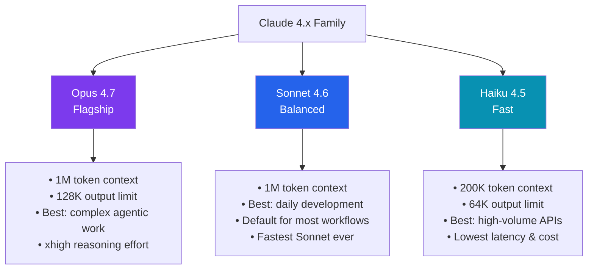

| Model | Context | Output | Released | Best For |
|---|---|---|---|---|
| **Claude Opus 4.7** | 1M tokens | 128K tokens | Apr 2026 | Complex reasoning, agentic coding |
| **Claude Sonnet 4.6** | 1M tokens | ~64K tokens | Feb 2026 | Balanced daily development |
| **Claude Haiku 4.5** | 200K tokens | 64K tokens | Oct 2025 | High-throughput, real-time tasks |

#### Model Selection and Switching
```bash
# Switch model in a session
/model claude-opus-4-7

# Switch to Sonnet (default)
/model claude-sonnet-4-6

# Switch to Haiku for speed
/model claude-haiku-4-5
```

#### Fast Mode
Fast Mode routes requests to Haiku 4.5 for near-instant responses, ideal for quick questions and simple edits.
```bash
# Toggle Fast Mode
/fast
```

> **Pro Tip — Model Routing Strategy:**
> - Use **Haiku 4.5** for quick lookups, simple questions, boilerplate
> - Use **Sonnet 4.6** for the majority of development tasks (best price/perf ratio)
> - Reserve **Opus 4.7** for complex architectural decisions, hard bugs, or large refactors

---

## 2. Core Concepts

### 2.1 Architecture Overview

#### How Claude Code Works

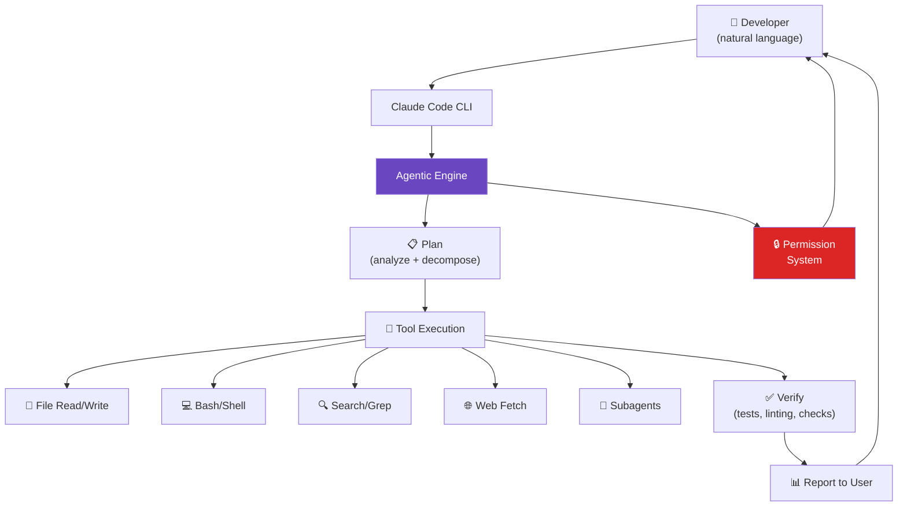

#### Autonomous Process and Supervision

Claude Code follows an **agentic loop**:

1. **Understand** — Parse user intent
2. **Explore** — Read relevant files, check structure
3. **Plan** — Decompose into ordered steps
4. **Execute** — Run tools (read, write, bash, search)
5. **Verify** — Run tests, check diffs, lint
6. **Report** — Summarize what was done

At each step, the **permission system** may pause for human approval before proceeding.

#### Tool Execution System

Tools are the atomic actions Claude Code can take. Every action maps to a specific tool call, which is logged and can require user approval. Tools are typed, sandboxed, and auditable.

---

### 2.2 Working Directory and Environment

#### Git Repository Integration
Claude Code is designed to operate **within a git repository**. On startup:
- It detects the project root (by finding `.git/`)
- It reads `.claude/settings.json`, `CLAUDE.md`, and any hooks
- It scopes all file operations to the repository boundary

```bash
# Claude Code respects git boundaries
cd /path/to/my-repo
claude  # Operates within /path/to/my-repo
```

#### Project Context Detection
On initialization, Claude Code automatically reads:
- `CLAUDE.md` (project instructions)
- `package.json`, `pyproject.toml`, `Cargo.toml`, etc. (project type)
- `.claude/settings.json` (configuration)
- Git history for recent context

#### Environment Variables
```json
// .claude/settings.json
{
  "env": {
    "NODE_ENV": "development",
    "DATABASE_URL": "postgresql://localhost/mydb",
    "API_BASE_URL": "http://localhost:3000"
  }
}
```

---

### 2.3 Identity and Capabilities

#### What Claude Code Can Do ✅
- Read, write, and edit any file within the project
- Execute shell commands (with approval)
- Run tests, builds, linters
- Perform Git operations (commit, branch, PR, merge)
- Search the web for documentation
- Spawn subagents to parallelize tasks
- Interact with MCP-connected external services
- Maintain memory across sessions via `CLAUDE.md` and memory files
- Schedule recurring tasks (cron-style)

#### What Claude Code Cannot Do ❌
- Access files outside the project root (by default)
- Execute destructive commands without approval
- Bypass explicit `deny` rules in settings
- Remember context across sessions without explicit memory files
- Connect to services not configured via MCP
- Act without triggering the permission system for sensitive ops

#### Safety Guardrails
- All write operations require confirmation (unless `acceptEdits` mode)
- Bash commands require approval
- Deny rules always override allow rules
- Irreversible actions (e.g., `rm -rf`) trigger extra warnings
- Sandboxing can be enabled at the OS level (`--sandbox` flag)

---

## 3. Commands and Skills

### 3.1 Built-in Commands

These are commands you type directly in the Claude Code session:

| Command | Description | Example |
|---|---|---|
| `/model [name]` | Switch the active model | `/model claude-opus-4-7` |
| `/fast` | Toggle Fast Mode (Haiku) | `/fast` |
| `/config` | Open settings management | `/config` |
| `/clear` | Reset conversation history | `/clear` |
| `/compact` | Compress history to save context | `/compact` |
| `/plan [task]` | Enter Plan Mode | `/plan add user auth` |
| `/help` | Show all available commands | `/help` |
| `/permissions` | View/manage permission rules | `/permissions` |
| `/hooks` | Manage lifecycle hooks | `/hooks` |
| `/mcp` | List/manage MCP servers | `/mcp` |
| `/add-dir [path]` | Add directory to session context | `/add-dir ../shared-lib` |
| `/context` | View context usage stats | `/context` |
| `/fork [name]` | Branch the current conversation | `/fork experiment` |
| `/rewind` | Revert to a previous state | `/rewind` |
| `/doctor` | Diagnose installation issues | `/doctor` |
| `/exit` / `/quit` | Exit the session | `/exit` |

#### `!` Prefix — Interactive Shell Commands
```bash
# Run a shell command without leaving Claude Code
!git status
!npm test
!ls -la src/
```

The `!` prefix drops into your shell inline, showing output directly in the session.

---

### 3.2 Skills (Slash Commands)

Skills are **reusable, structured task definitions** stored as `SKILL.md` files. Claude can invoke them like commands, or autonomously decide to use them when relevant.

**Skill locations:**
- **Project scope:** `.claude/skills/<name>/SKILL.md` (committed to git, shared with team)
- **Global scope:** `~/.claude/skills/<name>/SKILL.md` (available in all projects)

#### Built-in / Common Skills

| Skill | Command | Purpose |
|---|---|---|
| Clean Code | `/clean-code` | Enforces pragmatic coding standards (no over-engineering, clean naming) |
| Simplify | `/simplify` | Refactors complex code into simpler, more readable form |
| Security Review | `/security-review` | Audits code for common vulnerabilities (OWASP, injection, etc.) |
| Init | `/init` | Generates a `CLAUDE.md` bootstrapped from your project |
| Mermaid Diagram | `/mermaid-diagram` | Creates a Mermaid diagram from a description or code |
| Interactive Diagram | `/interactive-diagram` | Generates an interactive HTML diagram |
| Review | `/review` | Runs a pull request review analysis |
| Update Config | `/update-config` | Helps configure `.claude/settings.json` |
| Keybindings Help | `/keybindings-help` | Lists all keyboard shortcuts |
| Fewer Permission Prompts | `/fewer-permission-prompts` | Analyzes and suggests allow-list rules to reduce friction |
| Loop | `/loop` | Sets up a recurring/automated task |
| Claude API | `/claude-api` | Scaffolds code to use the Anthropic SDK |

---

### 3.3 Creating Custom Skills

A skill is just a folder with a `SKILL.md` file. Here's the structure:

```
.claude/
  skills/
    my-skill/
      SKILL.md          ← Required: instructions + YAML frontmatter
      scripts/          ← Optional: helper scripts
      examples/         ← Optional: reference implementations
      resources/        ← Optional: templates, assets
```

**Example `SKILL.md`:**
```markdown
---
name: api-scaffold
description: Scaffolds a new REST API endpoint with controller, service, and DTO
---

# API Scaffold Skill

When invoked, this skill creates a complete NestJS endpoint.

## Steps

1. Ask the user for the resource name (e.g., "user", "product")
2. Create the following files:
   - `src/{resource}/{resource}.controller.ts`
   - `src/{resource}/{resource}.service.ts`
   - `src/{resource}/dto/create-{resource}.dto.ts`
3. Register the module in `app.module.ts`
4. Run `npm run build` to verify compilation
```

**Invoke it:**
```
/api-scaffold
```

> **Best Practice:** Keep skills focused on a single concern. If a skill does too much, split it.

---

## 4. Operational Modes

### 4.1 Default Mode (Direct Action)

In **Default Mode**, Claude Code:
- Reads files without asking
- Asks before editing files (unless `acceptEdits` is set)
- Asks before running bash commands
- Executes the agentic loop autonomously

Most users operate in Default Mode for day-to-day work.

---

### 4.2 Plan Mode

Plan Mode is a **read-only** mode designed to separate **thinking from doing**. Claude can explore the codebase and produce a plan, but cannot write files or run commands.

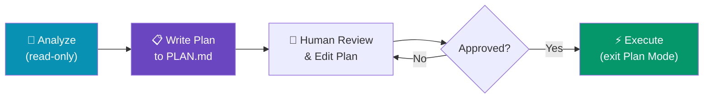

#### When Plan Mode Activates
- Manually via `/plan [task]`
- Started with `claude --permission-mode plan`
- Via `Shift + Tab` to cycle through modes

#### Plan File Structure
Plans are written to a markdown file (e.g., `PLAN.md` or `.claude/plan.md`):

```markdown
# Plan: Add User Authentication

## Analysis
- Current auth: none
- Target: JWT-based with refresh tokens
- Files affected: 8 files

## Steps
1. Install `@nestjs/jwt` and `passport-jwt`
2. Create `AuthModule`, `AuthService`, `AuthController`
3. Add `JwtStrategy` and `LocalStrategy`
4. Update `UserModule` to expose `UserService`
5. Add `@UseGuards(JwtAuthGuard)` to protected routes
6. Write tests for auth flow
7. Update `.env.example` with JWT_SECRET

## Risks
- Breaking change to existing /users endpoints
- Need to migrate existing sessions
```

#### Approving and Modifying Plans
You can edit the `PLAN.md` file directly before approving. Claude will execute the approved version.

#### Exiting Plan Mode
```bash
# Cycle through modes with Shift+Tab
# Or explicitly exit:
/mode default
```

---

### 4.3 Agent Mode (Subagents)

Subagents are **isolated Claude instances** spawned by the main agent to handle specific subtasks. Each subagent has:
- Its own context window
- A custom system prompt
- Specific tool access
- Independent permissions

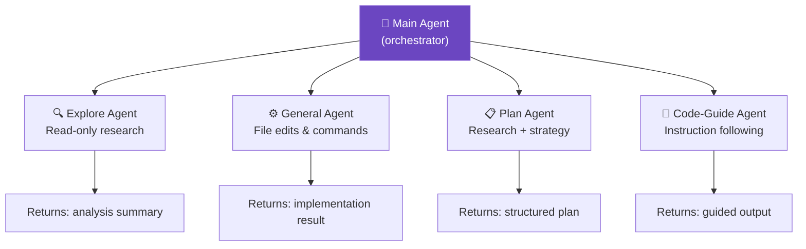

#### Explore Agent
- **Purpose:** Reads and analyzes code without making changes
- **Use case:** "Understand this codebase before we refactor it"
- **Benefit:** Keeps the main context clean; only the summary is returned

#### General-Purpose Agent
- **Purpose:** Full access — reads, writes, executes commands
- **Use case:** Delegating a self-contained sub-task
- **Benefit:** Parallel execution; isolated error scope

#### Plan Agent
- **Purpose:** Research and produce structured implementation plans
- **Use case:** Planning a complex feature before touching code
- **Benefit:** Separates strategy from execution

#### Code-Guide Agent
- **Purpose:** Follows specific coding standards/instructions
- **Use case:** Enforcing a style guide on generated code
- **Benefit:** Consistent output style across large tasks

#### Agent Orchestration and Parallel Execution
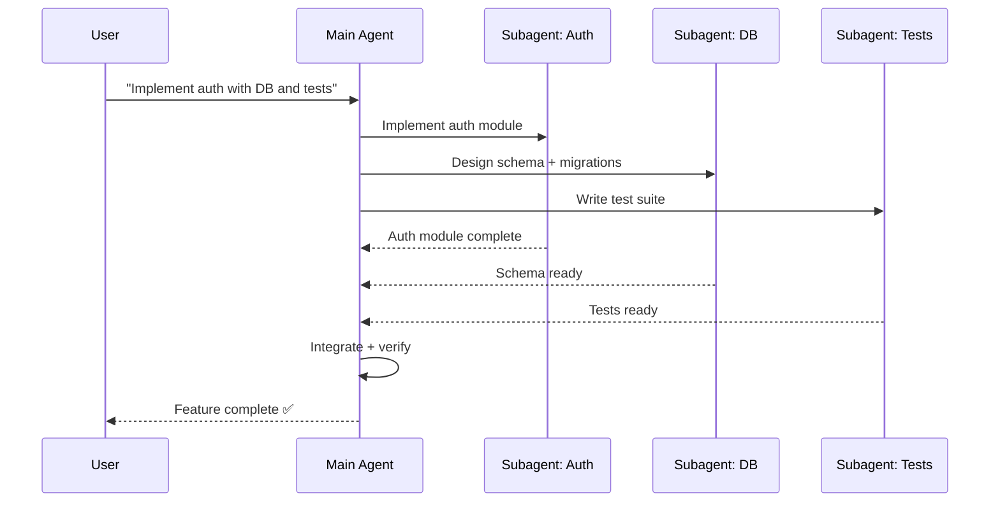

---

### 4.4 Ask Mode

Ask Mode is a **conversational-only** mode where Claude answers questions without taking actions.

| Mode | File Read | File Write | Bash | Shell |
|---|---|---|---|---|
| **Default** | ✅ | ⚠️ (approval) | ⚠️ (approval) | ⚠️ |
| **Accept Edits** | ✅ | ✅ | ⚠️ | ⚠️ |
| **Plan** | ✅ | ❌ | ❌ | ❌ |
| **Ask** | ✅ | ❌ | ❌ | ❌ |
| **Bypass** | ✅ | ✅ | ✅ | ✅ |

---

## 5. Context Window Management

### 5.1 Understanding Context Windows

The **context window** is Claude's working memory — everything Claude can "see" during a session.

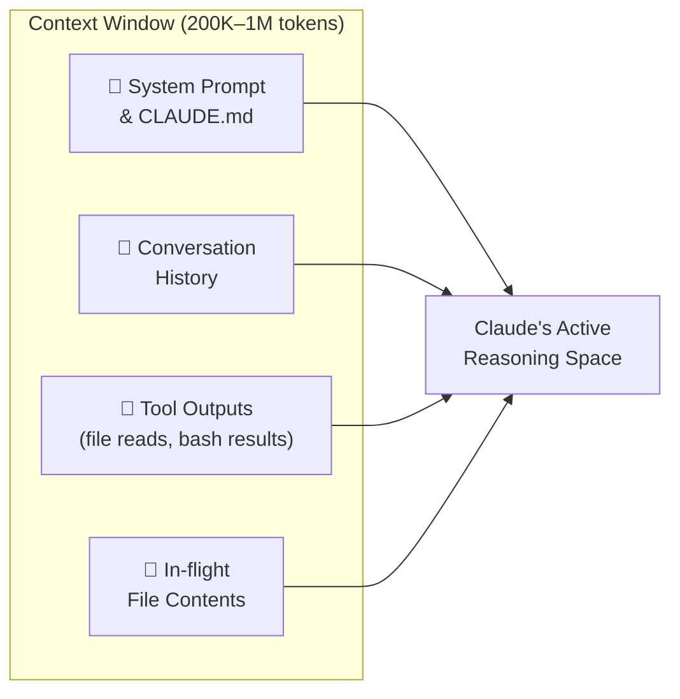

#### Token Limits and Budget

| Model | Context Window | Output Limit |
|---|---|---|
| Opus 4.7 | 1,000,000 tokens | 128,000 tokens |
| Sonnet 4.6 | 1,000,000 tokens | ~64,000 tokens |
| Haiku 4.5 | 200,000 tokens | 64,000 tokens |

**Rough token estimates:**
- 1 token ≈ 4 characters of English text
- 1,000 lines of code ≈ 10,000–15,000 tokens
- A `CLAUDE.md` file ≈ 500–2,000 tokens
- A large bash output ≈ 5,000–20,000 tokens

#### What Consumes Context
1. **CLAUDE.md** — injected every session
2. **Conversation history** — all prior messages
3. **Tool outputs** — file reads, bash results, web fetches
4. **System prompts** — skill instructions, mode prompts
5. **Inline file contents** — files Claude reads during the session

---

### 5.2 Automatic Compaction

When the context approaches its limit (~95% usage), Claude Code triggers **automatic compaction** in three tiers:

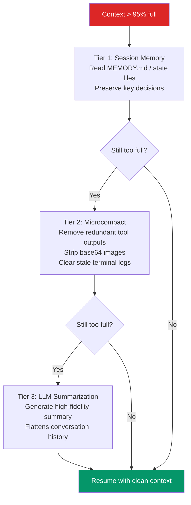

#### What Gets Summarized vs Preserved
| Preserved | Summarized/Removed |
|---|---|
| Architectural decisions | Exploratory code attempts |
| Unresolved bugs | Old tool outputs |
| Key file paths | Base64 image data |
| Active plan steps | Redundant reads |
| User preferences | Obsolete terminal output |

#### Working Through Compaction
- **Manual trigger:** `/compact` — Use at natural task boundaries
- **Post-compaction:** Claude will re-read `CLAUDE.md` and memory files to restore context
- **After `/clear`:** Full reset; Claude starts fresh (use when switching tasks)

---

### 5.3 Context-Efficient Practices

#### Efficient Tool Use
```
✅ Ask Claude to read only the files it needs
✅ Use grep/search instead of reading entire large files
✅ Request summaries instead of full file contents
❌ Avoid asking Claude to read the entire codebase at once
```

#### Batching Operations
Instead of:
```
"Read file A" → wait → "Now read file B" → wait → "Now edit both"
```

Do:
```
"Read A and B, then edit both to add error handling"
```

Batching reduces round-trips and saves context overhead.

#### Avoiding Redundant Reads
Use `CLAUDE.md` to document project structure so Claude doesn't need to re-explore on every session.

---

### 5.4 Context Monitoring

```bash
# Check current context usage
/context

# Output example:
# Context Usage: 47,823 / 200,000 tokens (23.9%)
# ├── System Prompt:    3,200 tokens
# ├── CLAUDE.md:        1,800 tokens
# ├── Conversation:    28,000 tokens
# └── Tool Outputs:    14,823 tokens
```

---

### 5.5 Anti-Patterns

| Anti-Pattern | Problem | Fix |
|---|---|---|
| Reading entire repo at start | Burns context quickly | Use grep/glob to find relevant files |
| Long multi-topic sessions | Context bloat, confusion | Use `/clear` between unrelated tasks |
| Pasting huge logs | Wastes tokens | Summarize logs, or use file reads |
| Relying on compaction for rules | Rules may be lost | Put rules in `CLAUDE.md` (never compacted) |
| Ignoring `/context` output | Silent context exhaustion | Monitor regularly for long sessions |

---

## 6. Memory System

### 6.1 Memory Architecture

Claude Code's memory is **file-based and explicit** — there is no hidden database. Everything Claude "remembers" across sessions lives in files you can inspect and edit.

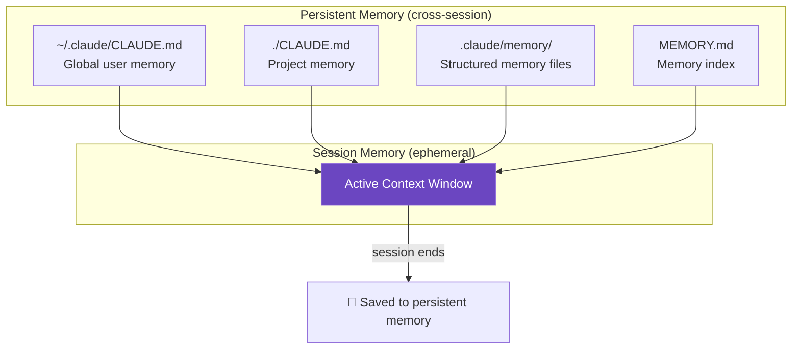

#### File-Based Memory
All memory lives in regular text/markdown files. You can:
- **Edit** memory files to correct stale information
- **Delete** entries to remove outdated context
- **Commit** memory files to version control (project memory)
- **Inspect** exactly what Claude knows

#### Memory Directory Structure
```
~/.claude/                     ← Global (all projects)
  CLAUDE.md                    ← Global user preferences
  memory/
    user-preferences.md
    global-patterns.md

.claude/                       ← Project (this repo)
  CLAUDE.md                    ← Project instructions
  settings.json
  memory/
    MEMORY.md                  ← Index of all memory files
    architecture.md
    debugging-notes.md
    feedback.md
```

---

### 6.2 Memory Types

#### User Memory (`~/.claude/CLAUDE.md`)
Global preferences that apply to all projects:
```markdown
# User Preferences

## Communication Style
- Keep responses concise
- Use TypeScript examples
- Prefer functional programming patterns

## Always Do
- Run tests after any code change
- Check for existing patterns before adding new ones
```

#### Feedback Memory
Stores corrections and adjustments the user has made:
```markdown
# Feedback Memory

## 2026-05-01
- User prefers `const` over `let` even for reassigned values
- Do not add JSDoc comments unless explicitly asked
```

#### Project Memory (`.claude/memory/`)
Project-specific context Claude has learned:
```markdown
# Architecture Notes

## Data Layer
- Uses TypeORM with PostgreSQL
- Repository pattern: always extend `BaseRepository`
- Migrations are in `src/database/migrations/`

## Naming Conventions
- Controllers: `{Resource}Controller`
- Services: `{Resource}Service`  
- DTOs: `Create{Resource}Dto`, `Update{Resource}Dto`
```

#### Reference Memory
Pointers to important files/resources:
```markdown
# Reference Memory

## Key Files
- Auth logic: `src/auth/auth.service.ts`
- Main config: `src/config/app.config.ts`
- DB seed: `src/database/seed.ts`
```

---

### 6.3 Memory Operations

#### Saving Memory
```
"Remember that we use snake_case for database columns but camelCase in TypeScript"
→ Claude writes to .claude/memory/conventions.md
```

#### Updating Memory
```
"Update the architecture notes — we've moved from REST to GraphQL"
→ Claude edits .claude/memory/architecture.md
```

#### Deleting Memory
```
"Remove the note about the old authentication system"
→ Claude deletes the relevant entry
```

#### Memory Frontmatter Format
```markdown
---
type: architecture
created: 2026-05-01
updated: 2026-05-20
project: dsquare2-be-v2
tags: [database, orm, patterns]
---

# Architecture: Data Layer
...
```

#### MEMORY.md Index
```markdown
# Memory Index

| File | Type | Topic | Updated |
|---|---|---|---|
| architecture.md | Architecture | Data layer, patterns | 2026-05-20 |
| conventions.md | Standards | Naming, formatting | 2026-05-15 |
| debugging-notes.md | Debug | Known bugs, fixes | 2026-05-18 |
```

---

### 6.4 Memory Best Practices

#### What TO Save ✅
- Architectural decisions and their rationale
- Project-specific naming conventions
- Recurring patterns and abstractions
- Known bugs or gotchas
- Preferred tool versions and commands
- Team preferences that differ from defaults

#### What NOT to Save ❌
- Temporary debugging output
- Session-specific one-off instructions
- Information that belongs in code comments or docs
- Sensitive credentials (use env vars instead)

#### Memory Staleness and Verification
> **Critical Rule:** Memory files can become stale. Always cross-reference memory against actual code before using it.

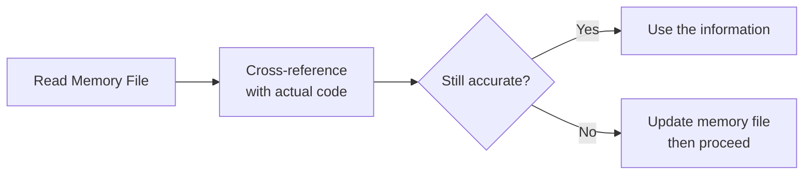

---

## 7. Tools and Tool Use

Claude Code's capabilities are implemented as **typed tool calls**. Every action is a tool invocation that can be logged, audited, and (for sensitive ops) requires approval.

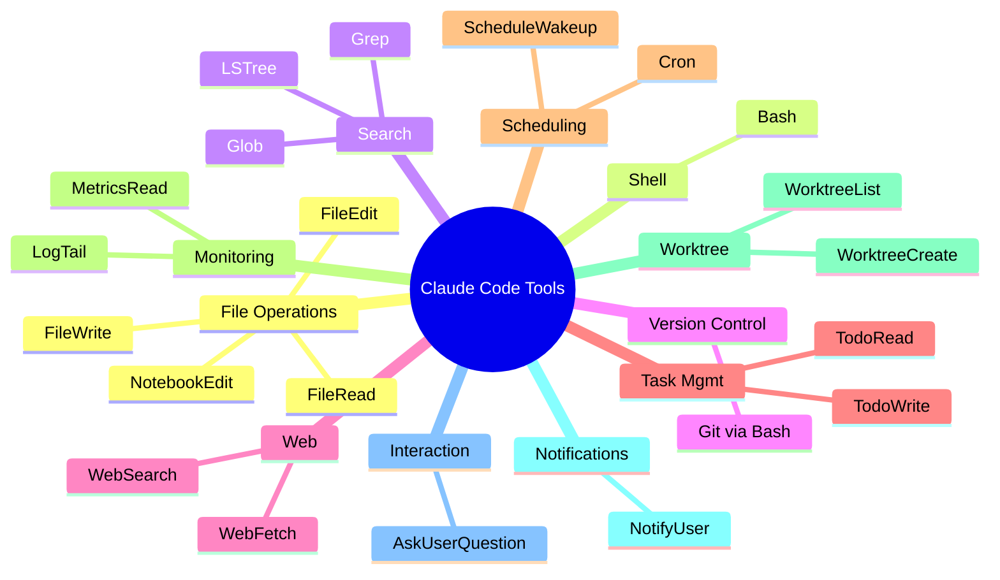

---

### 7.1 File Operations

| Tool | Description | Requires Approval |
|---|---|---|
| `FileRead` | Read file contents | ❌ Never |
| `FileEdit` | Edit existing file | ⚠️ Default mode |
| `FileWrite` | Create new file | ⚠️ Default mode |
| `NotebookEdit` | Edit Jupyter notebooks | ⚠️ Default mode |

```python
# FileRead — Claude reads your source
FileRead("src/auth/auth.service.ts")

# FileEdit — Targeted edit (diff-based)
FileEdit("src/auth/auth.service.ts", old="...", new="...")

# FileWrite — Create new file
FileWrite("src/auth/dto/login.dto.ts", content="...")
```

**Safety:** All write operations are scoped to the project root. Claude cannot write to parent directories or system directories without explicit override.

---

### 7.2 Shell Operations (Bash)

The `Bash` tool runs shell commands in your local environment.

```bash
# Examples of Bash tool use
npm run test
git status
npx tsc --noEmit
grep -r "TODO" src/
docker compose up -d
```

**Permission levels:**
- Read-only commands (`ls`, `cat`, `grep`) — often auto-approved
- Build/test commands — require first-time approval
- Destructive commands (`rm`, `DROP TABLE`) — always prompt

> **Best Practice:** Use `CLAUDE.md` to instruct Claude on preferred commands:
> ```markdown
> ## Build Commands
> - Test: `npm run test`
> - Build: `npm run build`
> - Lint: `npm run lint -- --fix`
> ```

---

### 7.3 Search and Navigation

| Tool | Purpose | Example |
|---|---|---|
| `Glob` | Find files by pattern | `Glob("src/**/*.service.ts")` |
| `Grep` | Search file contents | `Grep("implements AuthService", "src/")` |
| `LSTree` | Directory tree listing | `LSTree("src/auth/")` |

These tools are **never rate-limited by permissions** — they're read-only and safe.

---

### 7.4 Git Operations

Claude Code uses the `Bash` tool to run Git commands:

```bash
# Common Git operations Claude performs
git status
git diff --staged
git add src/auth/
git commit -m "feat(auth): add JWT refresh token support"
git checkout -b feature/auth-refresh
git push origin feature/auth-refresh
gh pr create --title "..." --body "..."
```

See [Section 10](#10-git-integration) for the full Git workflow.

---

### 7.5 Web Operations

| Tool | Purpose | Notes |
|---|---|---|
| `WebSearch` | Search the web | Good for docs, Stack Overflow, GitHub issues |
| `WebFetch` | Fetch a specific URL | Read documentation pages, API specs |

```
"Search for the latest NestJS JWT authentication docs"
→ WebSearch("NestJS JWT authentication guide 2026")
→ WebFetch("https://docs.nestjs.com/security/authentication")
```

---

### 7.6 Task Management

Claude Code maintains a **todo list** during sessions to track multi-step work:

```markdown
# Session Todo List
- [x] Read existing auth module
- [x] Design JWT strategy
- [ ] Implement AuthService
- [ ] Add guards to routes
- [ ] Write unit tests
- [ ] Update CLAUDE.md with auth notes
```

Tools: `TodoRead`, `TodoWrite` — Claude manages this automatically.

---

### 7.7 Scheduling (Cron, ScheduleWakeup)

Claude Code can schedule recurring tasks:

```bash
# Schedule a daily task
/loop "Run tests and report failures every morning at 9 AM"

# Uses cron-style scheduling
# Claude registers: 0 9 * * * claude "Run test suite and report"
```

`ScheduleWakeup` allows Claude to pause and resume later at a specified time.

---

### 7.8 Monitoring

Claude Code can monitor logs and metrics via `LogTail` and `MetricsRead` tools (when connected via MCP or shell):

```bash
# Tail application logs
!tail -f logs/app.log

# Monitor with Claude interpreting output
"Watch the server logs and tell me if any errors appear"
```

---

### 7.9 Worktree Management

For parallel work across branches, Claude Code supports **Git worktrees**:

```bash
# Create a worktree for a parallel feature
WorktreeCreate("feature/payments", "/path/to/project-payments")

# Work on two features simultaneously with separate agents
```

This is especially powerful combined with subagents — each agent works in its own worktree.

---

### 7.10 Notifications

The `NotifyUser` tool sends OS-level notifications when long tasks complete:

```
"Add auth, then notify me when done"
→ ... (runs for several minutes) ...
→ 🔔 "Claude Code: Auth implementation complete — 6 files changed"
```

---

### 7.11 User Interaction (AskUserQuestion)

When Claude needs clarification before proceeding, it uses `AskUserQuestion`:

```
Claude: "I found two patterns for error handling in this codebase:
  1. Custom exception filters (used in auth module)
  2. Try/catch with manual response (used in user module)

Which should I use for the new payments module?"

[1] Custom exception filters
[2] Try/catch pattern
[3] Let me explain my preference
```

---

## 8. Permission System

### 8.1 Permission Modes

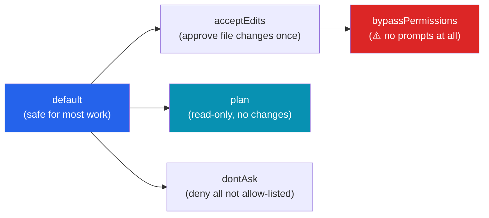

| Mode | File Edit | Bash | Description |
|---|---|---|---|
| `default` | Ask | Ask | Most common; safe baseline |
| `acceptEdits` | Auto-approve | Ask | Good for rapid file iteration |
| `plan` | ❌ Blocked | ❌ Blocked | Read-only planning |
| `dontAsk` | Deny unless allowed | Deny unless allowed | Strict allow-list only |
| `bypassPermissions` | Auto-approve | Auto-approve | ⚠️ Use only in trusted CI |

---

### 8.2 Permission Configuration

```json
// .claude/settings.json
{
  "permissions": {
    "allow": [
      "Bash(git status)",
      "Bash(git diff*)",
      "Bash(npm run test*)",
      "Bash(npm run lint*)",
      "FileEdit(src/**)"
    ],
    "deny": [
      "Bash(git push --force*)",
      "Bash(rm -rf*)",
      "FileEdit(.env*)",
      "FileEdit(secrets/**)"
    ]
  }
}
```

**Rule evaluation order:**
1. `deny` rules (always win — checked first)
2. `allow` rules
3. Mode default behavior

**Glob patterns in rules:**
```
Bash(git *)          → any git command
Bash(npm run test*)  → test commands only
FileEdit(src/**)     → any file under src/
FileEdit(*.env*)     → any .env file
```

---

### 8.3 Permission Best Practices

1. **Start restrictive, loosen gradually** — Add to allow-list as you discover needed commands
2. **Always deny sensitive files** — `.env`, `secrets/`, `*.pem`, `*.key`
3. **Always deny destructive commands** — `rm -rf`, `DROP DATABASE`, `git push --force`
4. **Use pattern specificity** — `Bash(npm run test*)` is better than `Bash(npm*)`
5. **Audit regularly** — Use `/permissions` to review accumulated allow rules

---

### 8.4 Reducing Permission Prompts

Use the `/fewer-permission-prompts` skill to analyze your workflow and generate a safe allow-list:

```bash
/fewer-permission-prompts

# Claude analyzes recent session history
# Identifies frequently approved commands
# Generates settings.json allow rules
# Output:
#
# Suggested additions to settings.json:
# "allow": [
#   "Bash(git status)",
#   "Bash(git diff*)",
#   "Bash(npm run build*)",
#   "Bash(npm run test*)"
# ]
```

---

## 9. Project Configuration

### 9.1 CLAUDE.md Files

`CLAUDE.md` is the **project brain** — a persistent system prompt loaded at every session start. It is **never compacted** and always takes priority.

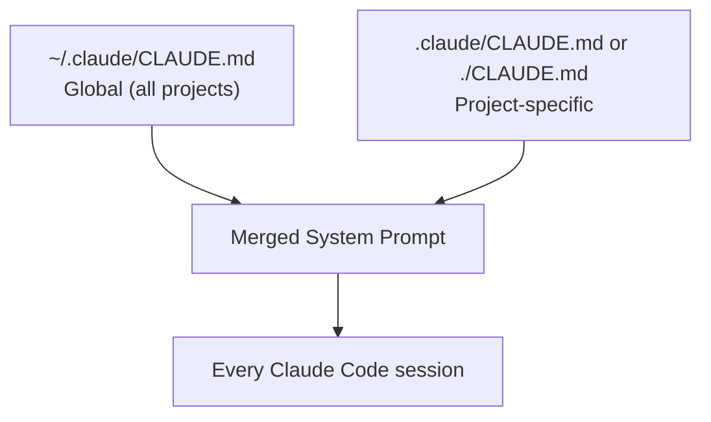

**Example `CLAUDE.md`:**
```markdown
# Project: Dsquare2 Backend

## Tech Stack
- NestJS 10, TypeScript, TypeORM, PostgreSQL
- Node 20, npm 10

## Build Commands
- Dev: `npm run start:dev`
- Build: `npm run build`
- Test: `npm run test`
- Test e2e: `npm run test:e2e`
- Lint: `npm run lint`

## Coding Standards
- Use `async/await`, never raw Promises
- All services must implement an interface
- DTOs use `class-validator` decorators
- Never commit `.env` files

## Architecture Patterns
- Repository pattern for all data access
- Use custom exception filters, not try/catch in controllers
- All API responses use `ResponseDto<T>` wrapper

## Git Workflow
- Branch naming: `feature/`, `fix/`, `chore/`
- Commit style: Conventional Commits (`feat:`, `fix:`, `refactor:`)
- Always run tests before committing

## Important Notes
- Database migrations live in `src/database/migrations/`
- Seeds are in `src/database/seeds/`
- Never modify migrations after they are committed
```

**Generate with `/init`:**
```bash
/init
# Claude analyzes your project and generates a CLAUDE.md
```

---

### 9.2 Settings Files (settings.json)

Configuration hierarchy (highest to lowest priority):

```
1. Managed settings (enterprise/admin)
2. CLI flags (--permission-mode, --model)
3. .claude/settings.local.json (personal, git-ignored)
4. .claude/settings.json (project, committed to git)
5. ~/.claude/settings.json (global user defaults)
```

**Full settings.json reference:**
```json
{
  "$schema": "https://claude.ai/schemas/settings.json",
  "model": "claude-sonnet-4-6",
  "permissionMode": "default",
  "env": {
    "NODE_ENV": "development",
    "LOG_LEVEL": "debug"
  },
  "permissions": {
    "allow": ["Bash(git *)", "Bash(npm run *)"],
    "deny": ["FileEdit(.env*)", "Bash(rm -rf*)"]
  },
  "mcpServers": {
    "github": {
      "command": "mcp-server-github",
      "args": [],
      "env": { "GITHUB_TOKEN": "${GITHUB_TOKEN}" }
    }
  },
  "hooks": {
    "PostToolUse": [
      {
        "matcher": "FileEdit",
        "hooks": [{ "type": "command", "command": "npm run lint -- --fix" }]
      }
    ]
  }
}
```

---

### 9.3 Hooks

Hooks execute **deterministic shell commands** at specific lifecycle events, regardless of Claude's judgment.

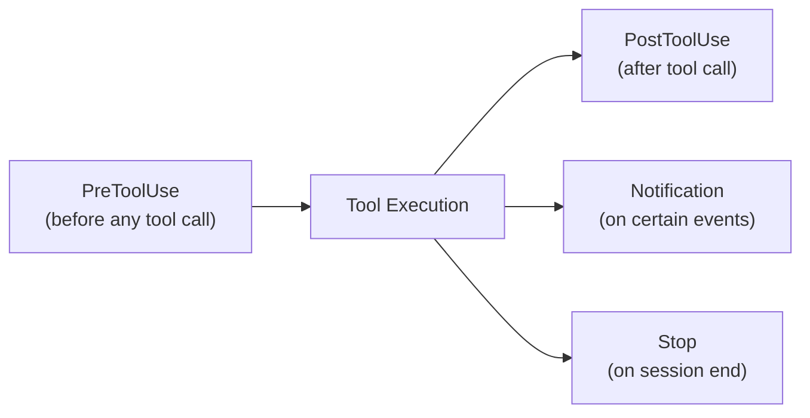

**Common hook patterns:**
```json
{
  "hooks": {
    "PostToolUse": [
      {
        "matcher": "FileEdit(*.ts)",
        "hooks": [{ "type": "command", "command": "npx tsc --noEmit" }]
      },
      {
        "matcher": "FileEdit(src/**/*.spec.ts)",
        "hooks": [{ "type": "command", "command": "npm run test -- --watch=false" }]
      }
    ],
    "PreToolUse": [
      {
        "matcher": "Bash(git commit*)",
        "hooks": [{ "type": "command", "command": "npm run lint && npm run test" }]
      }
    ]
  }
}
```

**Manage hooks interactively:**
```bash
/hooks
```

---

### 9.4 Keybindings

| Shortcut | Action |
|---|---|
| `Shift + Tab` | Cycle through modes (Default → AcceptEdits → Plan) |
| `Ctrl + C` | Cancel current operation |
| `Ctrl + R` | Reverse search conversation history |
| `↑ / ↓` | Navigate command history |
| `Tab` | Autocomplete slash commands |
| `Esc` | Dismiss current prompt |

View all keybindings:
```bash
/keybindings-help
```

---

## 10. Git Integration

### 10.1 Git Safety Protocol

Claude Code follows a conservative git safety protocol:

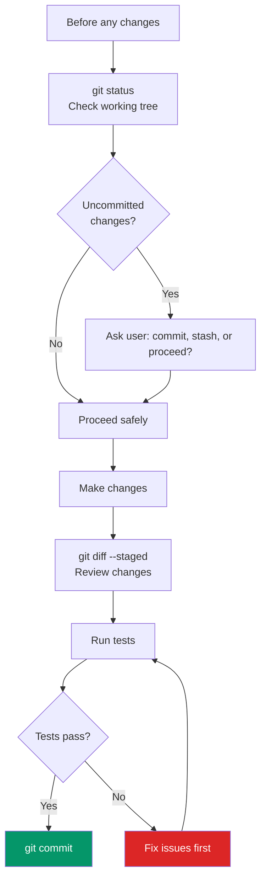

---

### 10.2 Committing Workflow

Claude Code uses **Conventional Commits** by default:

```bash
# Format
<type>(<scope>): <description>

[optional body]

[optional footer]

# Types
feat:      New feature
fix:       Bug fix
refactor:  Code restructure (no behavior change)
test:      Adding/updating tests
docs:      Documentation only
chore:     Build process, tooling
perf:      Performance improvement
ci:        CI/CD changes
```

**Example commit flow:**
```bash
git add src/auth/
git commit -m "feat(auth): implement JWT refresh token rotation

- Add RefreshTokenService with secure rotation logic
- Update AuthController with /auth/refresh endpoint
- Add token blacklist to prevent reuse after rotation

Closes #142"
```

---

### 10.3 Pull Request Creation

```bash
# Claude creates PRs using GitHub CLI
gh pr create \
  --title "feat(auth): implement JWT refresh tokens" \
  --body "## Summary
Implements secure JWT refresh token rotation.

## Changes
- \`RefreshTokenService\` with rotation logic
- \`/auth/refresh\` endpoint
- Token blacklist implementation

## Testing
- Unit tests: 100% coverage on token service
- E2E tests: Full auth flow tested

## Checklist
- [x] Tests passing
- [x] No breaking changes
- [x] Documentation updated" \
  --base main \
  --head feature/auth-refresh
```

---

### 10.4 Branch Management

```bash
# Claude's standard branch workflow
git checkout -b feature/payments-module    # Create feature branch
# ... make changes ...
git commit -m "feat(payments): ..."
git push origin feature/payments-module
gh pr create ...

# For hotfixes
git checkout -b fix/auth-token-expiry main
# ... fix ...
git commit -m "fix(auth): correct token expiry calculation"
```

---

### 10.5 Git Best Practices

| Practice | Command / Setting |
|---|---|
| Deny force push | `deny: ["Bash(git push --force*)"]` |
| Always run tests before commit | Hook: `PreToolUse` on `git commit` |
| Commit in small, focused chunks | Instruct via CLAUDE.md |
| Never commit to `main` directly | Enforce via branch protection |
| Tag releases | `git tag -a v1.0.0 -m "..."` |

---

## 11. Code Quality and Safety

### 11.1 Coding Standards

Claude Code is opinionated about clean code. Key principles baked into its default behavior:

```
✅ Small, focused functions (single responsibility)
✅ Descriptive variable and function names
✅ Meaningful error messages
✅ Consistent formatting (follows project linter/formatter)
✅ No unnecessary abstraction (YAGNI)
❌ No commented-out code left behind
❌ No magic numbers — use named constants
❌ No deep nesting — prefer early returns
```

Apply the `/clean-code` skill for a full standards audit:
```bash
/clean-code
# Reviews the current file or selection for code quality
```

---

### 11.2 Security Practices

Claude Code applies security-by-default thinking:

| Risk | What Claude Does |
|---|---|
| SQL Injection | Uses parameterized queries / ORM |
| XSS | Escapes output, sanitizes input |
| Secrets | Never hardcodes; uses env vars |
| Auth | Uses established libraries (passport, jwt) |
| File traversal | Validates paths before file ops |

Apply the `/security-review` skill:
```bash
/security-review
# OWASP Top 10 audit on specified files
```

---

### 11.3 Verification and Testing

Claude Code always verifies its own changes:

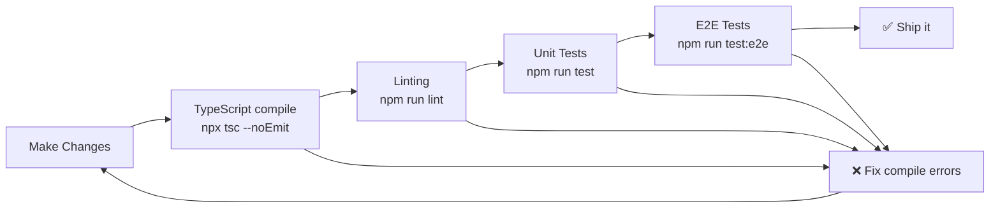

**Instruct verification in CLAUDE.md:**
```markdown
## Verification Steps (always run after changes)
1. `npx tsc --noEmit` — compile check
2. `npm run lint` — code style
3. `npm run test -- --coverage` — unit tests
4. Only commit if all pass
```

---

### 11.4 Code Review Practices

Use the `/review` skill for AI-powered code review:
```bash
/review
# Reviews recent changes or a specified PR

# Output includes:
# - Logic correctness
# - Edge cases missed
# - Security concerns
# - Performance notes
# - Naming/style feedback
```

---

## 12. Safety Guardrails

### 12.1 Action Reversibility

Before taking any action, Claude considers reversibility:

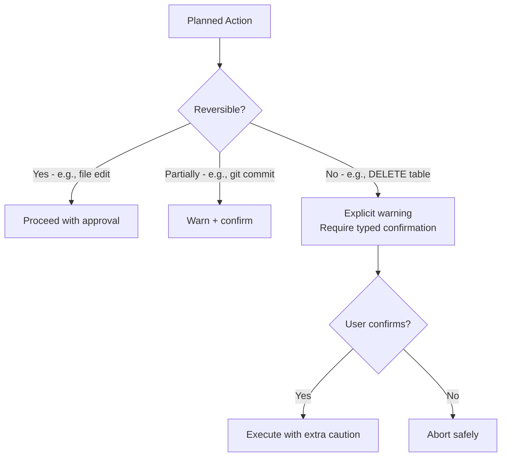

**Reversibility tiers:**
| Action | Reversibility | Behavior |
|---|---|---|
| File edit | ✅ Fully (git undo) | Normal approval |
| Git commit | ✅ Mostly (git reset) | Standard approval |
| File delete | ⚠️ Partial (git restore) | Warning shown |
| Database drop | ❌ Irreversible | Explicit confirmation |
| Push to remote | ⚠️ Partial (git revert) | Warning shown |

---

### 12.2 Destructive Operations

Claude Code identifies and handles destructive operations carefully:

```bash
# These trigger enhanced warnings:
rm -rf dist/
DROP TABLE users;
git push --force
truncate file.log

# Claude will:
# 1. Display the exact command
# 2. Explain what it does
# 3. Offer safer alternatives where possible
# 4. Require explicit confirmation
```

---

### 12.3 Content Safety

Claude Code refuses to:
- Generate malware, exploits, or attack scripts
- Help bypass authentication systems maliciously
- Generate content that violates Anthropic's usage policy
- Execute commands designed to cause harm to systems

---

### 12.4 Security Considerations

```bash
# Enable sandbox mode for extra security
claude --sandbox

# Restrict to read-only for exploration
claude --permission-mode plan

# Combine with .claude/settings.json deny rules
# for defense-in-depth
```

**Prompt injection risk:** If Claude reads a malicious file containing instructions, the permission system acts as a safety net — it still requires approval for sensitive actions even if "instructed" by file content.

---

## 13. Advanced Workflows

### 13.1 Multi-File Refactoring

```
"Rename the User entity to Account across the entire codebase.
Update all imports, references, DTOs, and tests.
Then run the compiler to verify."
```

Claude's approach:
1. `Grep` all occurrences of `User` (filtered to entity references)
2. `Glob` all affected files
3. Batch `FileEdit` operations
4. Run `npx tsc --noEmit` to validate
5. Run tests to confirm behavior unchanged
6. Commit with descriptive message

---

### 13.2 Feature Implementation

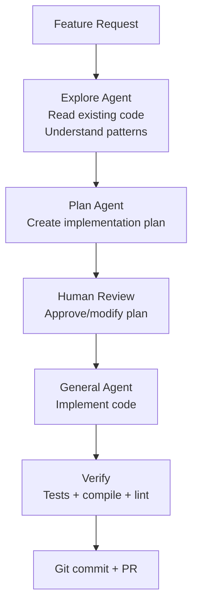

**Example prompt:**
```
"Implement a product wishlist feature:
- Users can add/remove products
- Persist in DB (new table)
- API: POST/DELETE /wishlist/:productId, GET /wishlist
- Follow existing auth guard patterns
- Write tests
Use plan mode first."
```

---

### 13.3 Bug Investigation and Fixing

```
"The login endpoint returns 401 for valid credentials.
Investigate the auth flow end-to-end and fix the bug."
```

Claude's approach:
1. Read the error logs
2. Trace the code path: controller → service → strategy → guard
3. Form a hypothesis
4. Write a minimal failing test to reproduce
5. Fix the root cause
6. Confirm tests pass
7. Commit

---

### 13.4 Codebase Exploration

```
"Give me an architectural overview of this codebase.
What are the main modules? How do they interact?
What patterns are used?"
```

Claude will:
1. Read `package.json`, `README.md`
2. `LSTree` the `src/` directory
3. Read module registration files (`app.module.ts`)
4. Produce a Mermaid architecture diagram
5. Write findings to `.claude/memory/architecture.md`

---

### 13.5 Parallel Work

Using subagents and worktrees to work on multiple features simultaneously:

```bash
# Main agent orchestrates
"Implement payments and notifications in parallel.
Create separate worktrees for each."

# Spawns:
# Subagent 1 → worktree: feature/payments
# Subagent 2 → worktree: feature/notifications
# Both run simultaneously
# Main agent merges when both complete
```

---

### 13.6 Long-Running Tasks

For tasks that take > 30 minutes:

```bash
# Use notifications
"Migrate all 200 test files to the new testing framework.
Notify me when done."

# Claude works autonomously, notifies when complete
# 🔔 "Migration complete: 200/200 files updated, all tests passing"
```

Use `/loop` for recurring long-running jobs:
```bash
/loop "Every day at 8 AM: run tests, check for security updates, report results"
```

---

### 13.7 Recurring Tasks

```bash
/loop "Every Monday morning: 
1. Pull latest from main
2. Run full test suite
3. Check for dependency updates (npm outdated)
4. Create a summary report in reports/weekly-$(date).md"
```

---

## 14. Best Practices

### 14.1 Communication Style

**Effective prompts:**
```
✅ "Implement JWT auth with refresh tokens. Use the existing UserService.
   Follow NestJS patterns from the auth module. Write unit tests."

❌ "Add auth to the app"  ← too vague
❌ "Please could you maybe add some sort of authentication?"  ← too hedging
```

**Provide constraints:**
```
✅ "Refactor the UserService — but don't change the public API.
   All existing tests must still pass."
```

---

### 14.2 Task Scoping


**Ideal task scope:**
- Has a clear start and end point
- Affects 1–5 related files
- Can be verified by running tests
- Takes 5–30 minutes of work

---

### 14.3 Verification Practices

Always ask Claude to verify its own work:
```
"After implementing, run the tests and show me the results.
If any fail, fix them before reporting back."
```

Use hooks to enforce verification automatically:
```json
{
  "hooks": {
    "PreToolUse": [
      {
        "matcher": "Bash(git commit*)",
        "hooks": [{ "type": "command", "command": "npm run test" }]
      }
    ]
  }
}
```

---

### 14.4 Context Management

| Strategy | When to Use |
|---|---|
| `/clear` | Switching to a completely different task |
| `/compact` | Long session getting sluggish, before a new phase |
| `/context` | Check how full the window is |
| `/add-dir` | Need to reference a sibling repo |
| `CLAUDE.md` | Persist rules that must survive any compaction |

---

### 14.5 Tool Selection

Claude selects tools automatically, but you can guide it:
```
"Use grep to find it, don't read the whole file"
"Read only the auth module, not the entire src/"
"Use the Explore subagent for research, then implement"
```

---

### 14.6 Error Handling

When Claude hits an error:
1. It reads the full error message
2. Forms a hypothesis
3. Attempts a fix
4. Re-runs verification
5. If stuck after 2–3 attempts, asks for human guidance

You can instruct error handling behavior in `CLAUDE.md`:
```markdown
## On Errors
- If a command fails, show the full output before trying to fix
- If stuck after 2 attempts, ask for clarification instead of guessing
```

---

### 14.7 Documentation

Claude maintains documentation as part of its workflow:
```
"After implementing this feature, update the README with 
API documentation for the new endpoints."
```

Or via hooks:
```json
{
  "hooks": {
    "PostToolUse": [
      {
        "matcher": "FileEdit(src/**/**.controller.ts)",
        "hooks": [{ "type": "command", "command": "npm run docs:generate" }]
      }
    ]
  }
}
```

---

## 15. Troubleshooting

### 15.1 Common Issues

| Issue | Cause | Fix |
|---|---|---|
| "Context limit reached" | Session too long | `/compact` or `/clear` |
| Repeated permission prompts | Missing allow rules | `/fewer-permission-prompts` |
| Claude ignores CLAUDE.md rules | Compaction removed them | Put rules in CLAUDE.md (never compacted) |
| Wrong model being used | Default config | `/model claude-opus-4-7` |
| Slow responses | Using Opus for simple tasks | `/fast` or `/model claude-haiku-4-5` |
| MCP server not responding | Config error | `/mcp` → check server status |
| Wrong file edited | Vague instructions | Be more specific about file paths |

---

### 15.2 Debugging Strategies

```bash
# Check Claude Code installation
/doctor

# Check current context usage
/context

# Check active permissions
/permissions

# Check MCP connections
/mcp

# Check active model
/model

# View hooks configuration
/hooks
```

**For stuck agents:**
```
"Stop what you're doing. Tell me what you've done so far 
and what the current error is."
```

---

### 15.3 Getting Help

```bash
# In-session help
/help

# Command-specific help
/help permissions
/help hooks
/help mcp

# Anthropic documentation
# https://docs.anthropic.com/claude-code

# Community
# https://discord.gg/anthropic
```

---

## 16. API and SDK Integration

### 16.1 Claude API Basics

The Claude API is the programmatic interface to Claude models. Use it to build your own Claude-powered applications.

```python
# Python SDK
import anthropic

client = anthropic.Anthropic(api_key="your-api-key")

message = client.messages.create(
    model="claude-sonnet-4-6",
    max_tokens=1024,
    messages=[
        {"role": "user", "content": "Explain async/await in TypeScript"}
    ]
)
print(message.content[0].text)
```

```typescript
// TypeScript SDK
import Anthropic from "@anthropic-ai/sdk";

const client = new Anthropic({ apiKey: process.env.ANTHROPIC_API_KEY });

const message = await client.messages.create({
  model: "claude-sonnet-4-6",
  max_tokens: 1024,
  messages: [{ role: "user", content: "Explain async/await in TypeScript" }],
});
console.log(message.content[0].text);
```

---

### 16.2 Anthropic SDK

Install:
```bash
pip install anthropic        # Python
npm install @anthropic-ai/sdk  # Node.js / TypeScript
```

**Streaming responses:**
```typescript
const stream = await client.messages.stream({
  model: "claude-sonnet-4-6",
  max_tokens: 1024,
  messages: [{ role: "user", content: "Write a NestJS service" }],
});

for await (const chunk of stream) {
  process.stdout.write(chunk.delta?.text ?? "");
}
```

---

### 16.3 Advanced Features

#### Prompt Caching
Reduces cost by up to 90% for repeated static content:
```typescript
const response = await client.messages.create({
  model: "claude-sonnet-4-6",
  max_tokens: 1024,
  system: [
    {
      type: "text",
      text: "You are an expert NestJS developer...",
      cache_control: { type: "ephemeral" }, // Cache this system prompt
    },
  ],
  messages: [{ role: "user", content: "Add auth to the user module" }],
});
```

**Cache hierarchy:** `tools → system → messages` (set `cache_control` on the last item in each static block)

#### Tool Use (Function Calling)
```typescript
const response = await client.messages.create({
  model: "claude-sonnet-4-6",
  max_tokens: 1024,
  tools: [
    {
      name: "get_weather",
      description: "Get current weather for a city",
      input_schema: {
        type: "object",
        properties: {
          city: { type: "string", description: "City name" },
        },
        required: ["city"],
      },
    },
  ],
  messages: [{ role: "user", content: "What's the weather in Hanoi?" }],
});

// Claude responds with a tool_use block
if (response.stop_reason === "tool_use") {
  const toolCall = response.content.find((b) => b.type === "tool_use");
  // Execute the tool and send result back
}
```

#### Batch API
Process many requests cost-effectively (50% cheaper):
```typescript
const batch = await client.messages.batches.create({
  requests: [
    {
      custom_id: "request-1",
      params: {
        model: "claude-haiku-4-5",
        max_tokens: 256,
        messages: [{ role: "user", content: "Summarize: ..." }],
      },
    },
    // ... up to thousands of requests
  ],
});

// Poll for results
const results = await client.messages.batches.results(batch.id);
```

---

### 16.4 Building with Claude API

Use the `/claude-api` skill to scaffold integrations:
```bash
/claude-api
# Generates boilerplate for:
# - API client setup
# - Error handling
# - Rate limit retry logic
# - Streaming setup
# - Tool use patterns
```

**Rate limits (as of 2026):**
| Tier | RPM | TPM | Cost |
|---|---|---|---|
| Free | 5 | 25K | $0 |
| Build | 1000 | 1M | Pay-per-token |
| Scale | 5000 | 10M | Volume discounts |

---

## 17. MCP (Model Context Protocol)

### 17.1 What is MCP?

**Model Context Protocol** is an open standard that allows Claude Code to connect to external tools, data sources, and APIs through a standardized interface — like a "universal adapter" for AI tools.

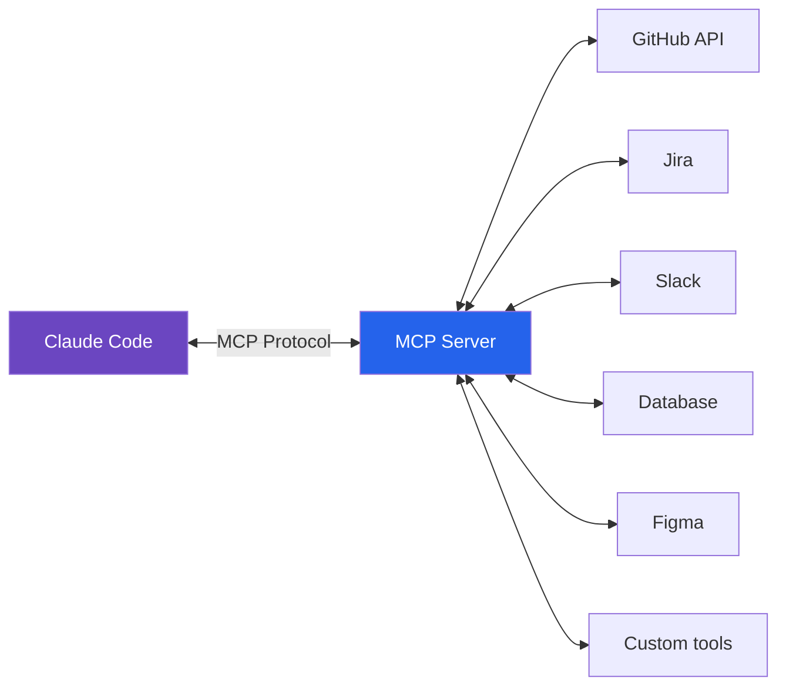

**Benefits:**
- No custom integration code per service
- Standardized authentication
- Discoverable tool capabilities
- Community-built servers available

---

### 17.2 Using MCP Tools

**Configure an MCP server in settings.json:**
```json
{
  "mcpServers": {
    "github": {
      "command": "npx",
      "args": ["-y", "@modelcontextprotocol/server-github"],
      "env": {
        "GITHUB_PERSONAL_ACCESS_TOKEN": "${GITHUB_TOKEN}"
      }
    },
    "postgres": {
      "command": "npx",
      "args": ["-y", "@modelcontextprotocol/server-postgres"],
      "env": {
        "POSTGRES_CONNECTION_STRING": "${DATABASE_URL}"
      }
    }
  }
}
```

**Manage MCP servers:**
```bash
/mcp
# Lists connected servers and their status

# Common MCP servers:
# @modelcontextprotocol/server-github   → GitHub PRs, issues, code
# @modelcontextprotocol/server-postgres → Query your database
# @modelcontextprotocol/server-slack    → Slack messages/channels
# @modelcontextprotocol/server-figma   → Design tokens, components
# @modelcontextprotocol/server-jira    → Tickets and sprints
```

**Use MCP tools naturally:**
```
"Check the GitHub issues labeled 'bug' and create a fix plan"
→ Claude uses GitHub MCP server to fetch issues
→ Creates implementation plan based on real issue data

"Query the production database for the top 10 slowest queries"
→ Claude uses Postgres MCP server to run EXPLAIN ANALYZE
→ Identifies and explains performance problems
```

---

### 17.3 Building MCP Servers

Create custom MCP servers for your internal tools:

```typescript
// Custom MCP server (TypeScript)
import { Server } from "@modelcontextprotocol/sdk/server/index.js";
import { StdioServerTransport } from "@modelcontextprotocol/sdk/server/stdio.js";

const server = new Server(
  { name: "my-internal-tools", version: "1.0.0" },
  { capabilities: { tools: {} } }
);

server.setRequestHandler("tools/list", async () => ({
  tools: [
    {
      name: "deploy_to_staging",
      description: "Deploys the current branch to staging",
      inputSchema: {
        type: "object",
        properties: {
          branch: { type: "string", description: "Branch name" },
        },
        required: ["branch"],
      },
    },
  ],
}));

server.setRequestHandler("tools/call", async (req) => {
  if (req.params.name === "deploy_to_staging") {
    const branch = req.params.arguments.branch;
    // Execute deployment logic
    return { content: [{ type: "text", text: `Deployed ${branch} ✅` }] };
  }
});

const transport = new StdioServerTransport();
await server.connect(transport);
```

**Register your custom server:**
```json
{
  "mcpServers": {
    "internal-tools": {
      "command": "node",
      "args": ["./mcp-servers/internal-tools.js"]
    }
  }
}
```

---

## 18. Performance Optimization

### 18.1 Response Time

| Technique | Impact | How |
|---|---|---|
| Use Haiku for simple tasks | 5–10x faster | `/fast` or `/model claude-haiku-4-5` |
| Prompt caching | 2–5x faster on repeated prompts | `cache_control` on static content |
| Shorter system prompts | Reduce initial load | Keep CLAUDE.md focused |
| Batch operations | Fewer round-trips | "Do A, B, and C in one pass" |

---

### 18.2 Context Efficiency

```mermaid
graph LR
    A["Full file read\n(expensive)"] --> B["Grep + targeted read\n(efficient)"]
    C["Sequential tasks\n(slow)"] --> D["Batched + parallel\n(fast)"]
    E["No CLAUDE.md\n(re-explore every session)"] --> F["Rich CLAUDE.md\n(instant context)"]
```

**Token budget by operation (approximate):**
| Operation | Tokens Used |
|---|---|
| Read 100-line file | ~1,500 |
| Grep search results | ~200–500 |
| Full bash output | ~1,000–5,000 |
| CLAUDE.md (typical) | ~500–2,000 |
| One conversation turn | ~200–1,000 |

---

### 18.3 Parallel Execution

```
# Sequential (slow)
"Add auth, then add payments, then add notifications"

# Parallel (fast)
"Implement auth, payments, and notifications in parallel.
Use separate subagents for each."
```

Use Git worktrees for true parallelism:
```bash
# Three simultaneous features, three worktrees
git worktree add ../project-auth feature/auth
git worktree add ../project-payments feature/payments
git worktree add ../project-notifs feature/notifications
```

---

## 19. Integration with Development Tools

### 19.1 IDE Integration

**VS Code:**
```bash
# Install extension
code --install-extension anthropic.claude-code

# Features:
# - Inline code completions
# - Panel chat (Ctrl+Shift+P → "Claude: Open Chat")
# - Right-click → "Ask Claude" on selected code
# - Diff viewer for proposed changes
```

**JetBrains (IntelliJ/WebStorm/PyCharm):**
- Install via JetBrains Marketplace → search "Claude"
- Same features as VS Code extension
- Supports project-aware context

---

### 19.2 CI/CD Integration

```yaml
# GitHub Actions — Claude Code in CI
name: Claude Code Review
on: [pull_request]

jobs:
  claude-review:
    runs-on: ubuntu-latest
    steps:
      - uses: actions/checkout@v4
      - name: Run Claude Code Review
        env:
          ANTHROPIC_API_KEY: ${{ secrets.ANTHROPIC_API_KEY }}
        run: |
          claude --permission-mode bypassPermissions \
            "Review the changes in this PR. 
             Check for security issues, bugs, and code quality.
             Output findings to pr-review.md"
      - name: Comment PR
        uses: actions/github-script@v7
        with:
          script: |
            const review = require('fs').readFileSync('pr-review.md', 'utf8');
            github.rest.issues.createComment({
              issue_number: context.issue.number,
              owner: context.repo.owner,
              repo: context.repo.repo,
              body: review
            });
```

---

### 19.3 Version Control Integration

```bash
# Pre-commit hook (using hooks config)
{
  "hooks": {
    "PreToolUse": [
      {
        "matcher": "Bash(git commit*)",
        "hooks": [
          { "type": "command", "command": "npm run lint && npm run test" }
        ]
      }
    ]
  }
}

# Or traditional git hook at .git/hooks/pre-commit:
#!/bin/sh
npm run lint && npm run test
```

---

## 20. Real-World Examples

### 20.1 Case Study: Adding Authentication

**Scenario:** Add JWT authentication to an existing NestJS API

**Step 1 — Plan Mode:**
```
/plan "Add JWT authentication to the NestJS API.
Users should be able to register, login, and access protected routes.
Use existing User entity. Follow existing code patterns."
```

**Step 2 — Review plan, then execute:**
```
Plan approved. Execute.
```

**What Claude does:**
1. Reads `src/app.module.ts` for existing module structure
2. Reads `src/user/user.entity.ts` for User schema
3. Installs `@nestjs/jwt`, `@nestjs/passport`, `passport-jwt`, `bcrypt`
4. Creates `AuthModule`, `AuthService`, `AuthController`
5. Creates `JwtStrategy`, `LocalStrategy`
6. Adds `@UseGuards(JwtAuthGuard)` to protected routes
7. Writes unit tests for all auth flows
8. Updates `.env.example` with `JWT_SECRET`, `JWT_EXPIRES_IN`
9. Runs tests, fixes failures, commits

**Time:** ~8 minutes | **Files changed:** ~12

---

### 20.2 Case Study: Debugging Production Issue

**Scenario:** Orders are intermittently failing in production

```
"Production issue: order creation fails with 'deadlock detected'
error about 5% of the time. Error log attached.
Investigate and fix."
```

**Claude's investigation:**
1. Reads the error log (stack trace analysis)
2. Traces to `OrderService.create()` method
3. Identifies concurrent inventory lock pattern
4. Reads `InventoryService` for lock mechanism
5. Diagnoses: two concurrent orders locking same SKU in different order
6. Writes failing test that reproduces the deadlock
7. Fixes by enforcing consistent lock ordering (sort SKUs before locking)
8. Confirms test now passes
9. Commits: `fix(orders): prevent deadlock by sorting inventory locks`

**Time:** ~15 minutes | **Root cause found and fixed**

---

### 20.3 Case Study: Large Refactoring

**Scenario:** Migrate from REST to GraphQL (100+ files)

```
"Plan the migration from our REST API to GraphQL.
Start with the User and Product modules only.
Keep REST endpoints running in parallel during migration."
```

**Claude's approach:**
1. Spawn Explore subagent to map all REST endpoints
2. Plan Agent creates migration strategy
3. Create feature branch: `feature/graphql-migration`
4. Install Apollo Server, GraphQL, `@nestjs/graphql`
5. Add GraphQL module alongside REST (parallel running)
6. Migrate User module → test → Migrate Product module → test
7. Write GraphQL schema tests
8. Document new queries/mutations in README
9. Create PR with migration guide

**Time:** ~45 minutes | **Zero downtime migration plan**

---

### 20.4 Case Study: Setting Up New Project

```
"Set up a new NestJS + TypeORM + PostgreSQL project.
Include: auth, user management, health checks, logging, 
validation, error handling, and Docker setup.
Generate CLAUDE.md for the project."
```

**Claude delivers:**
- Full NestJS project scaffold
- `docker-compose.yml` for dev environment
- TypeORM with migration setup
- JWT Auth module
- User CRUD with validation
- Global exception filter
- Request logging middleware
- Health check endpoint
- `.env.example` with all required vars
- `CLAUDE.md` with project-specific instructions
- `README.md` with setup guide

**Time:** ~20 minutes | **Production-ready starter**

---

## 21. Tips and Tricks

### 21.1 Productivity Hacks

```bash
# 1. Start every session with context check
"Quick status: what do you know about this project?"

# 2. Use CLAUDE.md for frequently typed instructions
# Instead of typing "always use async/await" in every session,
# put it in CLAUDE.md once.

# 3. Create project-specific skills for repetitive tasks
# .claude/skills/add-endpoint/SKILL.md
# → "/add-endpoint" scaffolds a full NestJS endpoint in seconds

# 4. Use /fork to experiment without losing progress
/fork experiment-graphql
# Try something risky, then return to original if it fails

# 5. Chain task completion
"After auth is done, start on the payments module automatically"
```

---

### 21.2 Hidden Features

| Feature | How to Access |
|---|---|
| Conversation branching | `/fork <name>` |
| Undo to previous state | `/rewind` |
| Add external repo context | `/add-dir ../sibling-repo` |
| Model switching mid-task | `/model claude-opus-4-7` |
| Force fast responses | `/fast` |
| Export conversation | `/export` (saves to markdown) |
| View full tool log | Session logs in `.claude/logs/` |

---

### 21.3 Power User Techniques

**1. Prompt Templates in CLAUDE.md:**
```markdown
## Common Task Templates

### For new API endpoints:
"Add a [METHOD] /[path] endpoint that [does X].
Use [Service]. Follow [pattern] from [existing file].
Write tests in [test file]."
```

**2. Multi-repo context:**
```bash
# Work across related repos
/add-dir ../shared-types
/add-dir ../api-client
"The shared types in ../shared-types need to match our backend DTOs"
```

**3. Self-documenting sessions:**
```
"As you work, append key decisions to .claude/memory/session-log.md"
```

**4. Automated morning routine:**
```bash
/loop "Every morning at 8:30 AM:
1. git pull origin main
2. npm run test
3. npm outdated
4. Report results to me"
```

---

## 22. Limitations and Workarounds

### 22.1 Known Limitations

| Limitation | Details |
|---|---|
| Context window | Even 1M tokens can be exhausted on massive codebases |
| Session memory | No persistent memory without explicit memory files |
| Binary files | Cannot meaningfully read images, PDFs (without vision) |
| Real-time data | No live data without MCP integration |
| Network access | WebSearch/WebFetch only; no arbitrary HTTP calls |
| Rate limits | API has per-minute and per-day token limits |
| Haiku accuracy | Haiku 4.5 less accurate on complex reasoning tasks |

---

### 22.2 Workarounds

| Limitation | Workaround |
|---|---|
| Context exhaustion | Use `/compact`, split into smaller tasks, use subagents |
| No session memory | Use CLAUDE.md + .claude/memory/ files |
| Large binary files | Describe the binary; use text exports/summaries |
| Real-time data | Add MCP server for your data source |
| Rate limits | Use Haiku for volume, Opus for quality |
| Complex reasoning on Haiku | Switch to Sonnet: `/model claude-sonnet-4-6` |

---

### 22.3 Feature Requests

Submit feature requests and report issues:
- **GitHub:** [github.com/anthropics/claude-code](https://github.com/anthropics/claude-code)
- **Feedback:** `/feedback` command in-session
- **Discord:** Anthropic Community Server

---

## 23. Comparison Matrix

### 23.1 Claude Code vs Cursor

| Feature | Claude Code | Cursor |
|---|---|---|
| **Primary interface** | Terminal | IDE (VS Code fork) |
| **Model** | Claude only | Multi-model (Claude, GPT-4, etc.) |
| **Context window** | 200K–1M tokens | Indexed embeddings |
| **Autonomous execution** | ✅ Full agentic | ⚠️ Mostly editing |
| **Shell command execution** | ✅ Yes | ❌ No |
| **Subagents** | ✅ Yes | ❌ No |
| **MCP support** | ✅ Yes | ⚠️ Limited |
| **Custom skills** | ✅ Yes | ❌ No (rules files only) |
| **Git operations** | ✅ Native | ❌ Manual |
| **Multi-file editing** | ✅ Yes | ✅ Yes (Composer) |
| **Cost** | Subscription/API | $20/mo Pro |
| **Best for** | Complex tasks, ops | Daily editing |

---

### 23.2 Claude Code vs GitHub Copilot

| Feature | Claude Code | GitHub Copilot |
|---|---|---|
| **Autocomplete** | ⚠️ Not primary | ✅ Excellent |
| **IDE integration** | Extensions | Deep native |
| **Enterprise security** | Emerging | Mature (SOC 2) |
| **Autonomous execution** | ✅ Yes | ❌ No |
| **Context size** | 1M tokens | File-level |
| **Codebase understanding** | ✅ Deep | ⚠️ Limited |
| **Custom rules** | CLAUDE.md | `.github/copilot-instructions.md` |
| **Price** | Claude.ai Pro | $10–$19/user/mo |

---

### 23.3 Claude Code vs ChatGPT

| Feature | Claude Code | ChatGPT (Code Interpreter) |
|---|---|---|
| **Local file access** | ✅ Full | Upload/download only |
| **Shell execution** | ✅ Local | Sandboxed cloud |
| **Git operations** | ✅ Native | ❌ No |
| **Real codebase** | ✅ Your actual code | Uploaded files only |
| **Context window** | 1M tokens | 128K tokens |
| **Persistence** | ✅ Memory files | Session only |
| **Best for** | Real engineering | Data analysis, learning |

---

## 24. Appendices

### 24.1 Glossary

| Term | Definition |
|---|---|
| **Agent** | An AI that autonomously executes tasks using tools |
| **Agentic loop** | The cycle of plan → execute → verify → report |
| **Compaction** | Summarizing conversation history to free context space |
| **Context window** | The active working memory available to the model |
| **CLAUDE.md** | Project instruction file loaded at every session start |
| **Hook** | A shell command triggered at a specific lifecycle event |
| **MCP** | Model Context Protocol — standard for external tool integration |
| **Plan Mode** | Read-only mode for analysis without making changes |
| **Skill** | A reusable task definition stored as a SKILL.md file |
| **Subagent** | An isolated Claude instance spawned for a specific subtask |
| **Token** | The smallest unit Claude processes (~4 characters) |
| **Tool call** | An atomic action Claude takes (read file, run bash, etc.) |
| **Worktree** | A separate git working directory linked to the same repo |

---

### 24.2 Command Reference

| Command | Args | Description |
|---|---|---|
| `/model` | `[model-id]` | Switch active model |
| `/fast` | — | Toggle Haiku Fast Mode |
| `/clear` | — | Reset conversation |
| `/compact` | — | Compress history |
| `/plan` | `[task]` | Enter Plan Mode |
| `/help` | `[topic]` | Show help |
| `/permissions` | — | Manage allow/deny rules |
| `/hooks` | — | Manage hooks |
| `/mcp` | — | Manage MCP servers |
| `/add-dir` | `[path]` | Add directory to context |
| `/context` | — | View context usage |
| `/fork` | `[name]` | Branch conversation |
| `/rewind` | — | Revert to previous state |
| `/doctor` | — | Diagnose installation |
| `/init` | — | Generate CLAUDE.md |
| `/export` | — | Export session to markdown |
| `/feedback` | — | Submit feedback |
| `/exit` | — | End session |

---

### 24.3 Configuration Reference

**settings.json Schema:**
```json
{
  "$schema": "https://claude.ai/schemas/settings.json",
  "model": "claude-sonnet-4-6",
  "permissionMode": "default | acceptEdits | plan | dontAsk | bypassPermissions",
  "env": { "KEY": "value" },
  "permissions": {
    "allow": ["Tool(pattern)", "..."],
    "deny": ["Tool(pattern)", "..."]
  },
  "hooks": {
    "PreToolUse": [{ "matcher": "ToolName", "hooks": [{ "type": "command", "command": "..." }] }],
    "PostToolUse": [{ "matcher": "ToolName", "hooks": [{ "type": "command", "command": "..." }] }],
    "Notification": [{ "matcher": "*", "hooks": [{ "type": "command", "command": "..." }] }],
    "Stop": [{ "matcher": "*", "hooks": [{ "type": "command", "command": "..." }] }]
  },
  "mcpServers": {
    "server-name": {
      "command": "executable",
      "args": ["arg1"],
      "env": { "ENV_VAR": "${ENV_VAR}" }
    }
  }
}
```

---

### 24.4 Error Code Reference

| Error | Meaning | Fix |
|---|---|---|
| `context_length_exceeded` | Context window full | `/compact` or `/clear` |
| `rate_limit_error` | Too many requests | Wait or switch to lower tier |
| `permission_denied` | Action blocked by rules | Check `/permissions` |
| `tool_execution_failed` | Shell command failed | Check command syntax |
| `mcp_server_unavailable` | MCP server not running | Check `/mcp` status |
| `authentication_error` | Invalid API key | Re-authenticate via `claude auth` |

---

### 24.5 Resources

| Resource | URL |
|---|---|
| Official Docs | https://docs.anthropic.com/claude-code |
| API Reference | https://docs.anthropic.com/en/api |
| Claude.ai | https://claude.ai |
| GitHub | https://github.com/anthropics/claude-code |
| MCP Docs | https://modelcontextprotocol.io |
| Community Discord | https://discord.gg/anthropic |
| Status Page | https://status.anthropic.com |
| Pricing | https://www.anthropic.com/pricing |

---

## 25. Quick Reference

### 25.1 Cheat Sheet

```
═══════════════════════════════════════════════════════════
  CLAUDE CODE CHEAT SHEET
═══════════════════════════════════════════════════════════

MODES (Shift+Tab to cycle)
  default      → Ask before writes and bash
  acceptEdits  → Auto-approve file changes
  plan         → Read-only analysis
  bypassPerms  → No prompts (CI only)

ESSENTIAL COMMANDS
  /model [id]  → Switch model
  /fast        → Toggle Haiku mode
  /clear       → Reset session
  /compact     → Compress context
  /plan        → Enter plan mode
  /context     → Check token usage
  /help        → Full help
  /doctor      → Diagnose issues

MODELS
  claude-opus-4-7     → Best reasoning (1M ctx)
  claude-sonnet-4-6   → Balanced default (1M ctx)
  claude-haiku-4-5    → Fast & cheap (200K ctx)

KEY FILES
  CLAUDE.md           → Project instructions (always loaded)
  .claude/settings.json → Config (committed)
  .claude/settings.local.json → Personal (git-ignored)
  .claude/memory/     → Persistent memory

CONTEXT TIPS
  ✅ Grep before reading full files
  ✅ Use /compact at task boundaries
  ✅ Put rules in CLAUDE.md (never compacted)
  ✅ Use subagents for parallel work
  ❌ Don't read entire codebase at once

PERMISSION RULES (settings.json)
  allow: ["Bash(git *)", "Bash(npm run *)"]
  deny:  ["FileEdit(.env*)", "Bash(rm -rf*)"]
═══════════════════════════════════════════════════════════
```

---

### 25.2 Decision Trees

#### Which Model Should I Use?

```mermaid
flowchart TD
    A["New task"] --> B{Complexity?}
    B -->|Simple question\nQuick lookup| C["Haiku 4.5\n/fast"]
    B -->|Regular dev work\nMost tasks| D["Sonnet 4.6\n(default)"]
    B -->|Complex architecture\nHard bug\nLarge refactor| E["Opus 4.7\n/model claude-opus-4-7"]
```

#### When to Use Plan Mode?

```mermaid
flowchart TD
    A["Incoming task"] --> B{Files affected?}
    B -->|1-2 files\nSmall change| C["Default mode\nDirect action"]
    B -->|3+ files\nArchitecture change| D{Risky?}
    D -->|Low risk| C
    D -->|High risk\nIrreversible changes| E["Plan Mode First\n/plan"]
```

#### Context Management Decision:

```mermaid
flowchart TD
    A["/context check"] --> B{Usage level?}
    B -->|< 50%| C["All good, continue"]
    B -->|50-80%| D["Consider /compact\nat next task boundary"]
    B -->|> 80%| E["/compact now"]
    B -->|> 95%| F["Auto-compaction triggered\nor /clear if switching tasks"]
```

---

### 25.3 Template Library

#### CLAUDE.md Template (NestJS Project)
```markdown
# Project: [Name]

## Stack
- NestJS [version], TypeScript [version]
- TypeORM + PostgreSQL
- Node [version], npm [version]

## Commands
- Dev: `npm run start:dev`
- Build: `npm run build`
- Test: `npm run test`
- Test E2E: `npm run test:e2e`
- Lint: `npm run lint`
- Type check: `npx tsc --noEmit`

## Standards
- async/await always (no raw Promise chains)
- DTOs with class-validator
- Repository pattern for data access
- Custom exception filters (no try/catch in controllers)
- Conventional Commits format

## Architecture
- Modules in `src/[module-name]/`
- Migrations in `src/database/migrations/`
- Seeds in `src/database/seeds/`

## Rules
- Never commit .env files
- Never modify committed migrations
- Always run tests before committing
- Use ResponseDto<T> wrapper for all API responses

## Git
- Branch: `feature/`, `fix/`, `chore/`, `docs/`
- Target branch for PRs: `main`
```

#### settings.json Template
```json
{
  "$schema": "https://claude.ai/schemas/settings.json",
  "model": "claude-sonnet-4-6",
  "permissionMode": "default",
  "env": {
    "NODE_ENV": "development"
  },
  "permissions": {
    "allow": [
      "Bash(git status)",
      "Bash(git diff*)",
      "Bash(git log*)",
      "Bash(git add*)",
      "Bash(git commit*)",
      "Bash(git checkout*)",
      "Bash(git push*)",
      "Bash(git pull*)",
      "Bash(npm run *)",
      "Bash(npx tsc*)",
      "Bash(ls*)",
      "Bash(cat*)",
      "Bash(grep*)"
    ],
    "deny": [
      "Bash(git push --force*)",
      "Bash(rm -rf*)",
      "Bash(DROP *)",
      "FileEdit(.env*)",
      "FileEdit(*.pem)",
      "FileEdit(*.key)"
    ]
  },
  "hooks": {
    "PostToolUse": [
      {
        "matcher": "FileEdit(*.ts)",
        "hooks": [{ "type": "command", "command": "npx tsc --noEmit 2>&1 | head -20" }]
      }
    ]
  }
}
```

#### Feature Request Prompt Template
```
Feature: [Feature Name]

Context: [What problem does this solve? Why is it needed?]

Requirements:
- [Requirement 1]
- [Requirement 2]
- [Requirement 3]

Constraints:
- Follow existing [pattern/module] patterns
- Don't break [existing functionality]
- API must remain backward compatible

Definition of Done:
- [ ] Implementation complete
- [ ] Unit tests written (>80% coverage)
- [ ] E2E test added
- [ ] Documentation updated
- [ ] All existing tests still pass

Use plan mode first.
```

---

*Document maintained by: [Your Team] | Version: 1.0 | Updated: May 2026*

*Sources: Anthropic official documentation, Claude Code changelog, community research*
