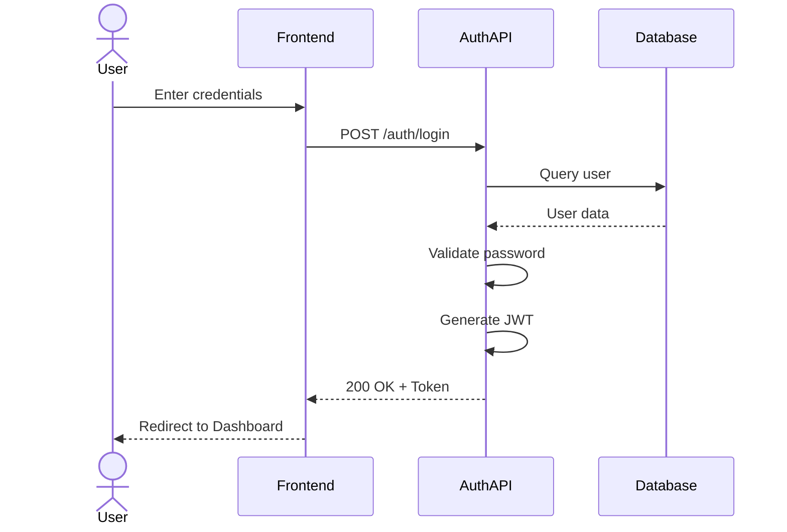
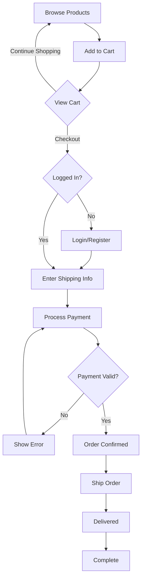
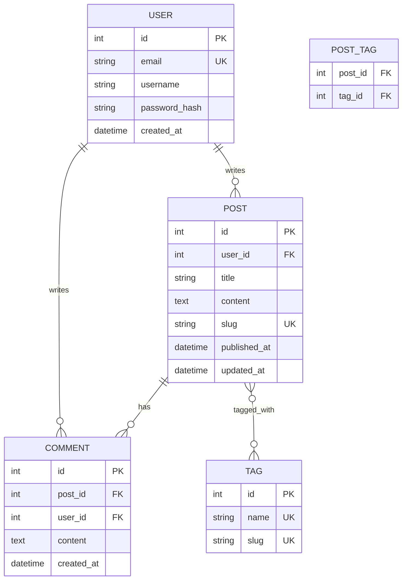
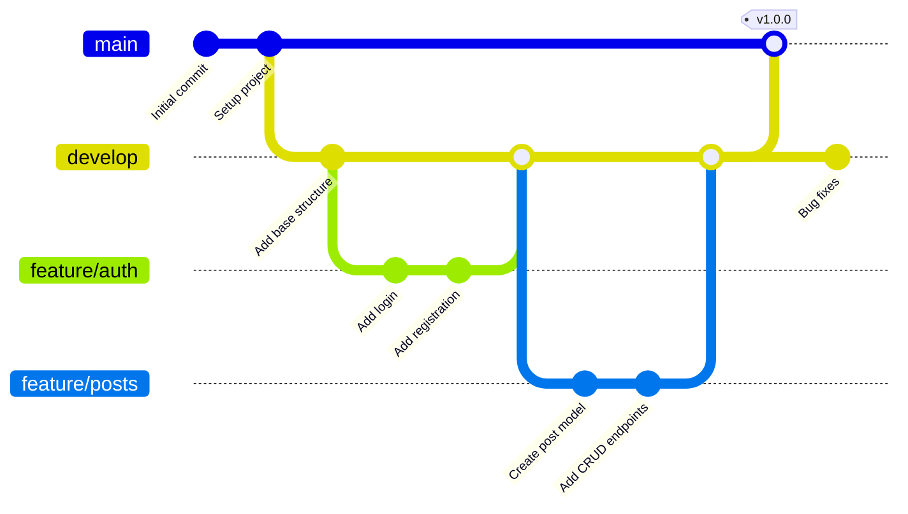
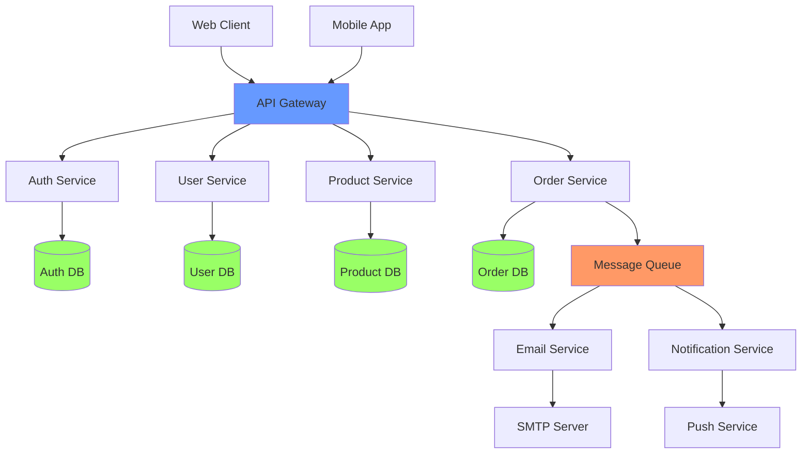
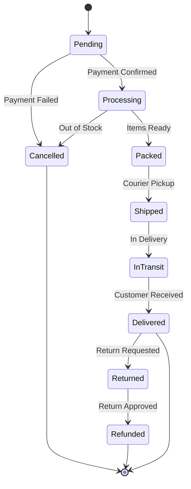
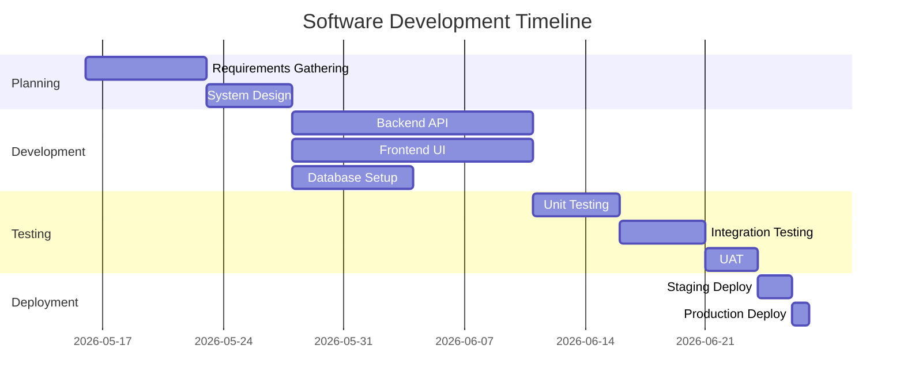

# Mermaid Diagram Examples

This file demonstrates the `/mermaid-diagram` skill usage.

## Example 1: User Authentication Flow

**Description:** Show the flow when a user logs into the system, validates credentials, generates a JWT token, and redirects to dashboard.

## Example 2: E-commerce Order Process

**Description:** Process flow from adding items to cart through payment and delivery.

## Example 3: Database Schema for Blog System

**Description:** Database relationships for a blog with users, posts, comments, and tags.

## Example 4: Git Branching Strategy

**Description:** Feature branch workflow with main, develop, and feature branches.

## Example 5: Microservices Architecture

**Description:** Microservices setup with API gateway, services, databases, and message queue.

## Example 6: Order State Machine

**Description:** Order lifecycle from pending to delivered or cancelled.

## Example 7: Project Timeline

**Description:** Software development project schedule with phases.

## How to Use the Skill

1. Type `/mermaid-diagram` in Claude Code
2. Describe what you want to visualize
3. Claude will generate the appropriate Mermaid diagram
4. Copy the markdown code block into your GitHub README or documentation

## Supported Diagram Types

- **Flowchart**: Process flows, decision trees
- **Sequence**: API interactions, message flows
- **Class**: OOP structure, UML diagrams
- **ER Diagram**: Database schemas
- **State**: State machines, lifecycles
- **Gantt**: Project timelines
- **Pie**: Data distributions
- **Git Graph**: Branch strategies
